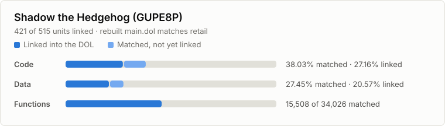

Shadow the Hedgehog (GameCube)
==============================

A work-in-progress matching decompilation of *Shadow the Hedgehog* (2005) for
the Nintendo GameCube. The C++ in `src/` compiles with the original Metrowerks
toolchain to code identical to the retail game, and every build relinks a
`main.dol` that matches retail byte for byte.

The card links to the full [progress page](https://2balanced.github.io/Shadow-GC-Decomp/progress.html)
(per-region breakdown, every unit, history). Both are regenerated by every build
and published from `docs/`.

This repository contains no game assets or code from the game. You need your
own copy of the game.

| ID       | Version   | `sys/main.dol` SHA-1                       |
| -------- | --------- | ------------------------------------------ |
| `GUPE8P` | USA Rev 0 | `118ef49ebd45b371b6f514e0e1b6d1ba7cf12904` |

Building
--------

Requires Python 3.10+ and [ninja](https://ninja-build.org/).

1. Put the disc image (ISO, RVZ, GCM, ...) in `orig/GUPE8P/`, or the extracted
   DOL at `orig/GUPE8P/sys/main.dol`.
2. Run `python configure.py`. It downloads the pinned decomp-toolkit, objdiff,
   compilers and binutils into `build/`.
3. Run `ninja`. The build is good when it ends with
   `build/GUPE8P/main.dol: OK`.

Contributing
------------

- [docs/matching-gadgets.md](docs/matching-gadgets.md): how to match a unit,
  shared types and project conventions.
- [docs/research-notes.md](docs/research-notes.md): compiler findings and the
  known blockers.
- [docs/toolchain.md](docs/toolchain.md): toolchain evidence, helper tools and
  reference projects.

Open [objdiff](https://github.com/encounter/objdiff) on the repository root to
compare functions against the retail game.

License
-------

[CC0 1.0](LICENSE): dedicated to the public domain. The vendored boost 1.32
headers in `include/boost/` keep the Boost Software License 1.0
(`include/boost/LICENSE_1_0.txt`).

Built on [decomp-toolkit](https://github.com/encounter/decomp-toolkit) and
[dtk-template](https://github.com/encounter/dtk-template). This project is
independent and contains no code from other decompilations of this game.
